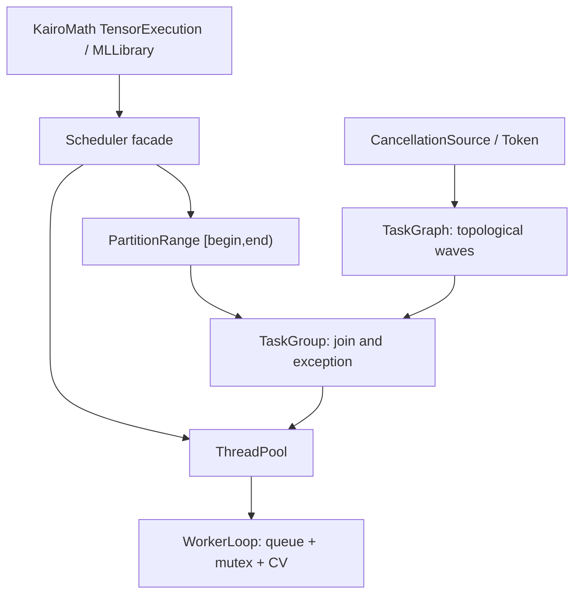

# KairoScheduler: tasks, lifetimes and parallel execution

This is a teaching companion to the [linked reading order](SOURCE_READING_ORDER.md) and the implementation in [KairoScheduler.cppm](../src/KairoScheduler.cppm). It describes bounded CPU concurrency, not GPU execution or a promise of speedup.

## 1. A scheduler is an ownership boundary

A graphics engine, machine-learning runtime or dataloader often needs to execute many independent CPU tasks. Rather than creating threads inside every mathematical function, KairoScheduler owns reusable workers and exposes a vocabulary for task groups, half-open ranges, cancellation and dependency graphs.

## 2. Partitioning must be safe and complete

A Range starts at begin and ends *before* end. Adjacent chunks must not overlap and must cover each requested index exactly once. PartitionRange uses quotient-and-remainder ceil division instead of adding count and chunkSize before dividing; the latter can overflow near SIZE_MAX. Its chunk order is deterministic, but actual worker execution order is not.

An elementwise Tensor kernel can safely dispatch workers to disjoint output chunks. A floating-point sum needs per-chunk partials and a defined combination order, because the addition order affects rounding.

## 3. ThreadPool: shared queue, explicit lifetime

ThreadPool owns a fixed vector of std::thread workers, a mutex-protected deque of std::function tasks, condition variables, completion counters and profiling statistics. Submit enqueues work under a lock. WorkerLoop releases the lock during the callback and records completion and first unhandled exception afterward. WaitIdle waits for all pending work and rethrows that exception to the caller.

The destructor sets the shutdown flag, wakes workers and joins them. Pending tasks are allowed to drain. A task must not retain dangling references to owner data, even though the pool itself is still alive. Stats are mutex-protected counters, not evidence of faster performance.

## 4. TaskGroup: why callbacks do not escape a stack frame

TaskGroup increments outstanding work *before* queue submission and rolls the count back if queuing throws. It catches exceptions in the queued callbacks, signals completion, and rethrows the first exception in Wait on the submitting thread. Submit after Wait is rejected. TaskGroup must outlive all its submitted callbacks.

The ParallelFor helper constructs one group, schedules disjoint ranges, and waits before returning. Because of that join, a callback capturing local variables by reference can be safe during the call. In contrast, direct ThreadPool::Submit without a join requires longer-lasting captures.

## 5. ParallelFor, serial fallback and oversubscription

ParallelFor uses the configured chunk size and worker count to decide whether to execute one whole-range callback sequentially or to partition work. Scheduler is the owning facade; its For method accepts an explicit ExecutionPolicy. Consumers such as KairoMath's TensorExecution can use scheduler ranges without owning threads.

An overly small chunk size produces many short tasks and high scheduling overhead. A callback that writes to shared data without synchronization is still a data race. Prefer owned output slices, thread-local partials, or justified atomic operations.

## 6. TaskGraph and cooperative cancellation

TaskGraph::Add stores a callable and dependency handles; dependencies must refer to earlier registered nodes. Execute groups nodes into sorted topological waves, waits for each wave, and reports a cycle if no ready work can finish the graph. Tasks within one wave may run in any order; nodes from later waves cannot run until their dependencies complete.

CancellationSource shares an atomic stop flag with CancellationToken. RequestStop asks for cooperative cancellation, not forced termination: callbacks that already started can complete. A long-running callback must periodically check StopRequested if it needs prompt cancellation.

## 7. Tests, benchmark and limitations

[smoke.cpp](../tests/smoke.cpp) checks range partitioning including SIZE_MAX, completion, worker exception handling and cancellation. It explicitly undefines NDEBUG so assert statements remain effective even in Release builds. [benchmark.cpp](../benchmarks/benchmark.cpp) runs a fixed CPU workload and emits JSON timing/checksum statistics. It is not a fair comparison against an optimized sequential reference without repeated controlled measurements.

[CMakeLists.txt](../CMakeLists.txt) builds the C++23 module and optional smoke/benchmark targets. No new compilation or test execution was performed during these documentation commits.

## 8. Exercises

Implement a deterministic parallel reduction by writing one partial sum per chunk and reducing partials in a stable order. Next create two independent TaskGraph jobs whose outputs feed a third job and check dependency order. Force one callback to throw and confirm Wait surfaces its exception without stranding other tasks. Finally benchmark several chunk sizes and worker counts against a sequential loop, recording warmup and hardware details.

For every use of the scheduler, ask: who owns the pool, what data each worker may mutate, how errors reach the caller, when callbacks finish, and what evidence demonstrates the chosen policy is worthwhile?
